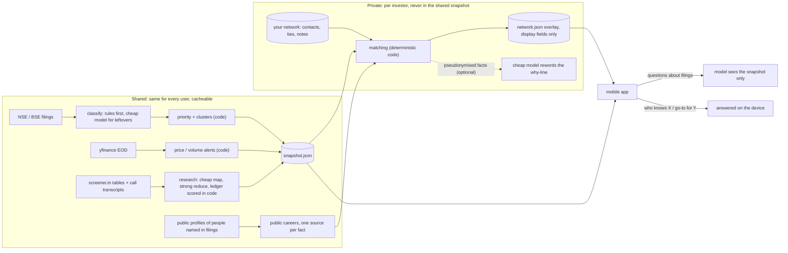

# FINN: Financial Investment Agent

FINN filters what reaches you. It reads every filing across a 15-stock portfolio and folds away about 70% of them. What remains is sorted into "needs you" and "worth knowing". Two things get special treatment. A results filing comes with a first cut of the numbers. A leadership change comes with the incoming person's background. On the pull side, FINN reads a company's last four earnings calls and scores each management promise against the reported numbers.

Underneath both sits the **Network**: who in your own network can help you understand this. A CEO change comes with your best way in to the new CEO. An acquisition or a court ruling names the one person best placed to explain it. The network is synthetic in this demo (31 fictional people, labelled SYN), and every link is scored in code from shared employers, years and batches.

**Try it on a phone:** https://finn-dist.vercel.app (or open `app/dist/index.html`). A "Start here" card on first open runs a three-stop tour: HDFC Bank's way in, Network coverage, and Kaynes' promise ledger. Replay it from the Data sheet.

```
app/
  index.html          the mobile app: one file, no build step, no framework
  snapshot.json       shared market data the app renders (same for every user)
  network.json        the investor's private network overlay (per user; never merged into the snapshot)
  dist/index.html     the app with both inlined, ready for any static host
backend/
  finn/
    sources/          prices.py (yfinance) · filings.py (NSE → BSE fallback) · screener.py · documents.py (PDF → text → chunks)
    classify.py       rules first, cheap model only for the leftovers
    priority.py       score → tier (act / know / noise) → cluster related filings
    results.py        Revenue/EBITDA/PBT/PAT, QoQ + YoY, and why the bottom line moved
    enrich.py         incoming-person bio · results read from the PDF when there's no table
    alerts.py         user-defined price/volume lines, per-stock overrides
    research/         metrics.py · ledger.py (promise vs delivery) · engine.py · prompts.py
    llm.py            two-tier model router, content-hash cache, cost meter
    snapshot.py       builds the app's JSON (live or replayed)
    network/          model.py (load + validate) · match.py (scoring) · explain.py (why-lines) · overlay.py
  data/inputs/        the real data captured for the demo (see "Data" below), incl. public_careers.json
  data/network/       network.json (PRIVATE, synthetic) · orgs.json (org register + value chain)
  tests/              70 tests on the deterministic core, with no network and no model
```

## Run it

```bash
cd backend && pip install -r requirements.txt
python -m pytest -q                       # 70 passed

python -m finn snapshot                   # replay captured inputs (offline)
python -m finn snapshot --live            # NSE/BSE + yfinance + screener.in, now
python -m finn import-linkedin Connections.csv   # your LinkedIn data export → network contacts
python -m finn network                    # → app/network.json (private overlay; add --model for model-worded why-lines)
python -m finn build-app                  # → app/dist/index.html (single file, deploy anywhere)

export GEMINI_API_KEY=...                 # free tier is enough
python -m finn research TATAMOTORS        # pull research on ANY NSE ticker
python -m finn serve                      # FastAPI: /snapshot, /research/{ticker}, /ask
```

To route the models elsewhere, set `FINN_CHEAP_PROVIDER/MODEL` and `FINN_STRONG_PROVIDER/MODEL`. The supported providers are `gemini`, `groq`, `ollama` (fully local) and `openai` (any OpenAI-compatible endpoint).

## What it does

**Brief (push, windowed digest).** The window defaults to 24 hours, with chips for 3, 7, 14 and 30 days or a custom date range. Every filing in the window gets a score and lands in one of three tiers:

| Tier | Gets | Example |
|---|---|---|
| Needs you (≥60) | an expanded card with enrichment | HDFC Bank CEO change; Sun Pharma PAT −36% |
| Worth knowing (30–59) | one line | Maruti's record October sales; Polycab's clean beat |
| Routine (<30) | folded into a count, grouped by type | call recordings, ESOP allotments, results ads, NCDs at lenders |

Related filings are clustered. The results filing, its deck, the call audio and the newspaper ad become one card with "+3 related filings folded in". The top three items form a readable summary, and **Listen** reads it aloud (en-IN) for the commute.

**Alerts (push, triggered).** Thresholds are written as a sentence with editable numbers: "Tell me when a holding moves more than ±4% in a day, or trades 2× its 20-day average volume." You can set a custom line for one stock and choose which filing categories you watch. The alert log re-runs the moment you change a number.

**Results.** A season scoreboard covers 13 of 15 holdings: a heat grid of revenue, EBITDA and PAT growth, plus the holdings still to report. Tap a row for QoQ, margins and the read-through.

**Research (pull).** It starts with a promise ledger. Each guidance item from the last four calls is given a checkable measure and scored in code as beat, delivered, on track, at risk, missed or walked back. Items that can't be measured stay unscored. The research view also covers story vs numbers, bull vs bear, a trajectory chart, cash quality, the balance sheet and working capital, what to watch next quarter, and sources. Every claim carries a source tag.

**Network (woven into Push and Pull).** Shows up at the moment it matters, not as a contact list. Throughout, a *material event* is a non-routine filing that names a new leader, or reports M&A, an equity raise, litigation, capex or an exchange clarification. It counts as *covered* when someone in the network has a medium or strong link to it.

- *Top of the brief → "From your network".* One card above the summary, in the first screen: the strongest network moment in the chosen window. In the default 24 hours that's the Kaynes acquisition, with the ex-Kaynes corp-dev contact. It also shows how many material events in that window your network covers, with the window named: "3 of 3 covered · last 24h". The pick is made in code: "needs you" first, then link strength.

- *Leadership change → "Your way in".* The best path is drawn inline: You → contact → (contact) → executive. Each line's thickness is that hop's strength, and the last hop is dotted because it is inferred. HDFC Bank's new CEO, Anup Bagchi: your best path is Vikram Rao, your IIT Kanpur batchmate, who overlapped with Bagchi at ICICI Bank for five years (2017–22) while Bagchi was Executive Director (strong). Next is Ritu Malhotra, whom you reach through your IIM-A batchmate Pranav (two hops). FINN also says your own link is weak: you're both IIT Kanpur alumni, but his graduation year isn't public. Trent's new chairman, Bahram Vakil: one medium path, through an ex-AZB lawyer. A contact who worked at Trent gets no link, because Vakil's Trent role was a board seat. Dixon's new ED has no public profile, so FINN says it can't compute a path and points to the ex-Dixon plant head instead.
- *Material event → "Best placed to explain".* One person and why: the ex-Kaynes corporate-development lead for Kaynes' acquisition, an insolvency lawyer for Polycab's NCLAT ruling, an ex-Bajaj risk head for Bajaj Finance's QIP. Each event type weighs expertise against knowing the company: litigation leans on the lawyer, and a clarification leans only on company knowledge.
- *Compliance built in.* A contact who works at the company today is flagged ("keep it to public information") and ranked last. An ECM banker on a fund raise gets "never live mandates". Reconnect nudges never point you at a current insider.
- *Research → "Who to call".* Ex-employees, competitors, suppliers and customers for the company, each with what to ask. The question is taken from the promise ledger: Kaynes' FY26 revenue miss goes to the ex-corp-dev contact, the operating-cash-flow miss to the ex-ops head, and the walked-back OSAT plan to a contact running an OSAT ramp-up.
- *Network tab.* Small on purpose. It shows how many material events your network covers, always with the window: 7 of 8 in the 7 days to 3 Nov (the snapshot date), and 9 of 10 across every material filing in the snapshot (15 Oct – 2 Nov). The one gap in both is Dixon: there's no path to its new ED. It also shows thin spots in the book, a "who's your go-to for…" map, and up to three "worth a call" reconnects. Those are people you haven't spoken to in months whose former employer just filed something, never a current insider.
- *Onboarding.* The real starting point is the investor's own LinkedIn data export (`Connections.csv`, which LinkedIn lets every member download): `python -m finn import-linkedin` turns it into contacts. Name, current company and title are kept; URL and email are dropped; unknown companies are flagged for review; join years are left blank rather than guessed.
  No scraping, ever. The demo network is synthetic; a test runs the importer on a synthetic sample export (`tests/fixtures/Connections_sample.csv`).
- Tap anyone for how you know them, their career, and every event they appear on. Tap "sources" for the real executive's career facts, each with its link.

**Ask.** A bar sits above the tabs on every screen. Network questions ("who knows Anup Bagchi?", "go-to for QIPs?", "who should I call about Polycab?"), and any question that names someone in your network, are answered on the device from the overlay and never sent to a model. Other questions go to Claude, with only the snapshot as context, when FINN runs as a Claude artifact. On the Vercel deploy there is no model behind the page, so a small on-device router answers the common questions.

## Key decisions

1. **Numbers never come from a model.** Models extract text and make judgements. Every figure on screen (QoQ, YoY, margins, CAGRs, CFO/PAT, the ledger verdicts) is computed in Python from source tables. This is the one rule I would not trade away in a finance product.
2. **The category isn't enough to set priority.** A results filing is signal; the newspaper ad repeating it is paperwork. Both are category `results`, so the classifier adds a subtype. Context changes priority too:
   - an NCD issue at a bank or NBFC is routine;
   - an "acquisition" that is really a CAD 5,000 shell subsidiary is noise;
   - a results filing is promoted to "needs you" only when profit fell or a line deteriorated. A clean beat is "worth knowing".
3. **The results card says why the bottom line moved.** Sun Pharma's PAT fell 36% while EBITDA grew 5%. FINN shows the gap sits below the operating line: other income fell ₹1,222 cr and the tax rate went from 25% to 37%. A PAT miss caused by a tax line and one caused by weak operations lead to different decisions.
4. **The promise ledger is scored, not summarised.** The model's job stops at turning a promise into a measure ("W&C EBIT margin, range 11–13%"). The verdict is arithmetic. That makes it auditable, and it surfaced real findings:
   - Kaynes: 0 of 3 scoreable promises kept. The newest guide was cut about 24% within a quarter.
   - Polycab: beat 2 of 3 margin guides and declined to raise them.
   - Persistent: the "$2bn by March 2027" target was quietly restated as an exit run-rate.
5. **The network is matched in code; a model writes at most one line.** Links are scored from evidence (same employer with overlapping years, same group, same batch, links you entered), decayed for age, and combined by noisy-OR. Every score comes with its reason. The "why call them" line is a template by default and labelled as such. With `--model`, the cheap model may reword it from pseudonymised facts, but it cannot change who is ranked or how.
6. **Real people are never "known".** People named in filings connect to your contacts only through public career overlap, with a source for each fact. Those links are marked hypothetical. Board seats don't count, and a year that isn't public is left out, never inferred. The loader rejects any "knows" link to a real person.
7. **Saying "can't tell" is allowed.** Qualitative promises stay unscored, with the evidence shown. When Dixon's captured page turned out to be standalone, FINN showed only the consolidated headline rather than mix bases. A person with no reliable public profile gets "no reliable profile found" instead of a guessed bio.

## Cost and efficiency

- **Classification.** All 72 captured filings are classified by ordered regex rules at zero cost; a test enforces this. The cheap model only sees what falls through, and its answer is cached by subject.
- **Transcripts.** Chunks are pre-filtered by keyword before any model sees them. Guidance lives in roughly 15% of a call, so only those 2–3 chunks are sent.
- **Routing.** A full research run on one ticker is about 12 cheap calls (Gemini Flash-Lite, ~$0.10 per 1M input tokens) and 2 strong calls (one to dedupe and attach measures, one to reduce). That comes to under $0.05 at list prices and $0 on the free tier.
- **Cache.** The cache is keyed by a hash of the content. Filings and transcripts never change, so re-running research on the same company costs nothing. `llm.METER` reports calls, cache hits, tokens and USD per tier.

## Data: what's real and what isn't

The build ran in a sandbox whose shell couldn't reach NSE, BSE, Yahoo or screener.in. The demo snapshot was therefore captured through a web-fetch tool and replayed through the same pipeline code.

- **Real:** quarterly results for all 15 holdings (screener.in, Q2 FY27); 72 announcements from their feeds; multi-year P&L, balance sheet, cash flow and ratios for the three research names; 8 earnings-call transcripts (Persistent ×4, Polycab ×2, Kaynes ×2) from NSE archives and company IR sites; incoming-executive bios from public profiles. All of it is in `backend/data/inputs/` with source URLs.
- **Simulated:** end-of-day price and volume series only. They are seeded and anchored to each stock's real last price, and marked SIM in the app. `--live` replaces them with yfinance bars.
- **Written by Claude in the build session:** the research reduce step (snapshot, story vs numbers, bull/bear) for the three demo names, from those primary sources only. In live mode `engine.run_live()` regenerates it with the strong tier. The ledger verdicts and every number are computed by code either way.
- **Synthetic: the whole network.** All 31 contacts, their ties and their notes are fictional and marked SYN. Seven employers (e.g. Hartwell Health, Meridian Capital, Kestrel Advisors) are fictional too, and marked so in `orgs.json`. Real companies appear only as places fictional people worked. The value chain (who supplies or buys from whom) is hand-curated by industry role, not claimed contracts.
- **Real, cited per fact:** the public career history of the three people named in leadership-change filings (`data/inputs/public_careers.json`), gathered by web search during the build. Sources include Business Today, Moneylife, CXO Digital Pulse, HDFC Bank's site and MarketScreener.
- **Templates, not a model:** every "why call them" line in the demo. No model call was made for the network.
- **Approximate:** filing dates for 5 holdings whose results filing fell outside the captured feed. These are inferred from the earliest results-related filing and marked "~".

## Deliberately left out

- **Real-time intraday data.** The brief says end-of-day, and an intraday feed is a different product with different costs.
- **Push notifications and accounts.** A background worker that diffs snapshots and calls a push service is about a day of plumbing that proves nothing new.
- **News, broker notes, sentiment.** Excluded on purpose (pull side: primary sources only).
- **Portfolio P&L and valuation models.** That's another app; FINN is about what changed.
- **Network search, a contact list, a graph view.** The Network answers questions at the moment they come up; it isn't a CRM.
- **Scraping profiles.** Not done, by design. See "How I'd do it for real" below.

## Next

1. A scheduled worker that runs `snapshot --live` after the market close and on each new filing, diffs against the last run, and sends web push for "needs you" items only.
2. A ledger that persists across quarters, so guidance credibility becomes a time series per management team and can feed back into priority (a missed guide from a 0-of-3 team ranks higher).
3. Results parsed straight from the exchange XBRL. NSE's integrated filings already carry tagged figures, which removes the table-scraping step.
4. Peer context on the results card: "PAT −36% vs pharma holdings +8%".
5. An evaluation set of ~200 hand-labelled filings to measure classifier and priority precision.
6. Onboarding past the LinkedIn import (which is built): a calendar scan for "last spoke", alma maters, and a review screen where the investor confirms company matches and adds join years.
7. Feedback on suggestions ("called them, useful / not useful") to tune the scoring weights per investor, still in code.

## Architecture, data security & privacy



### Data pipelines

The demo runs these on demand (`snapshot`, `network`). The refresh column is the production schedule.

| Source | Fetch | Refresh | Stored as |
|---|---|---|---|
| EOD price & volume | yfinance (`.NS`) | after the close | bars per ticker; alerts computed in code |
| Filings | NSE announcements API, BSE fallback | poll every 15 min in market hours | raw filing + label + score; PDFs text-extracted once and cached by content hash |
| Fundamentals | screener.in tables; transcripts from NSE archives / IR sites | on each results filing | tables as JSON; transcripts as text chunks, content-hash keyed (never re-processed) |
| People in filings | name from the filing (regex, cheap-model fallback) → web search → structured career | on each leadership-change filing | `public_careers.json`: one source per fact, unknown years left null |
| Your network | entered or imported by you | when you edit it | private per-user store (`network.json` in the demo) |

**Linking.** Names from filings are normalised (honorifics, case, initials) and must match exactly. An ambiguous name gets no link rather than a guess. Employers and institutions resolve to canonical IDs with aliases (`orgs.json`). Groups exist only where people move between entities (ICICI, Kotak, Reliance); Tata is deliberately not one employer. The overlay is rebuilt whenever the snapshot or the network changes. It's pure code over two inputs, so it's cheap and reproducible.

### Security & privacy

**In short:**
- The network is the investor's private data about other people, and those people haven't agreed to be in it. The demo avoids this by using 31 fictional contacts.
- Built and tested today: the network never enters the shared snapshot or a model's context, and the one optional model call sees a pseudonym.
- Designed for a real product under India's DPDP Act: contacts stay pending until they confirm a notice, their data serves one stated purpose, and anyone who withdraws is erased within 30 days.
- Not built yet, and not legal advice: the consent flow, deletion jobs and access control below still need building and a lawyer's review.

- **Separation.** Market data is shared and cacheable. The network and everything derived from it lives in a per-user overlay that is never merged into the snapshot; a test enforces this. **This demo is a public static page, so it bundles a synthetic network.** A real deployment serves the overlay only to its owner, behind auth, with `Cache-Control: private, no-store`.
- **Minimisation.** Each contact holds name, employers and years, education and year, themes, how you know them, and when you last spoke. No phone numbers or emails are needed to match. Your private notes and the last-spoke dates never leave the device; the overlay carries "N months ago". Matching needs no model at all.
- **Models see the minimum.** Network questions in Ask are answered on the device; the network is never put into the model's context. The optional why-line model sees `Contact A`, the one stint that matched, and the public event. It never sees the name, how you know them, your notes or the rest of the career. The name is put back locally. Its output is cached in the owner's private namespace (`cache/private/<owner>/`), never in the shared LLM cache. Tests cover both. In production, the provider would be configured for zero retention and no training.
- **The people in your network haven't consented.** That is the honest gap in any product like this. In this demo it doesn't arise, because all 31 contacts are fictional. In a real product it is the central legal design problem, so it gets its own section below.
- **Access control.** One owner per network, enforced in the database with row-level security keyed by user ID and encrypted at rest with a per-tenant key. Firm admins can't read it by default. Sharing is opt-in and per path ("send this way in to my analyst"), never the whole network. Every read of the network is audit-logged.
- **Compliance by default.** Current employees of a listed company are flagged and demoted, bankers get a "no live mandates" note on fund raises, and reconnect nudges skip insiders. An investment firm's compliance team should be able to read this logic, which is why it's code.

#### India's DPDP Act, 2023: consent, purpose, deletion

**Does the Act apply? Yes.**
- The Act doesn't cover "personal data processed by an individual for any personal or domestic purpose" (s. 3(c)(i)). A fund manager using contacts for investment work is acting professionally, so that exclusion doesn't apply. In the Act's terms, FINN (or the firm that deploys it) is the "Data Fiduciary", the party that decides why and how the data is used. Every contact is a "Data Principal", a person the data is about.
- A second exclusion covers information people chose to make public about themselves (s. 3(c)(ii)). At most, that reaches what a contact posted on their own profile. It does not cover the investor's notes, closeness ratings, "knows" links or the links FINN infers.
- Whether combining public data takes it back into the Act is unsettled. FINN therefore treats the whole network as in scope.

**Consent (s. 6).** The Act asks for consent that is "free, specific, informed, unconditional and unambiguous with a clear affirmative action" (s. 6(1)). In plain words: a person knowingly says yes to one stated use, and FINN may only use the data that use needs. They can take the yes back at any time, and taking it back must be no harder than giving it. The short list of uses that need no consent (s. 7, "certain legitimate uses") doesn't include a private map of someone's contacts. A real FINN would therefore:
1. Import every contact as **pending**, whether from the LinkedIn export, the address book or manual entry. A pending contact is matched only on what they published themselves: name, current employer and title. The investor's closeness rating, notes, past-employer years and "knows" links are added only after the contact consents.
2. Let the investor send each contact a short notice from their own account. It says what FINN stores, the one purpose, who sees it, and how to withdraw, with a one-tap confirm or decline. FINN keeps each yes on record, because the burden of proving consent sits with FINN.
3. Delete pending contacts who don't confirm within 90 days. Declining or withdrawing triggers deletion.

**Purpose limitation.** One stated purpose: telling the investor who in their own network can help them understand a company, a filing or a person.
- Nothing else. The network is not shared with colleagues or the firm, not used for marketing, not sold, and not used to train models.
- A new purpose, such as sharing a way in with an analyst, needs fresh, separate consent.

**Deletion (s. 8(7), s. 12(3)).** Once a contact takes back their consent, or FINN no longer needs their data for its one purpose, the data has to go, unless another law says to keep it. A contact can also ask for deletion directly. Any outside service that processes the data for FINN has to delete it too. FINN would:
- Erase a contact within 30 days from the network store, the private model cache, and any audit-log entries that reference them. Backups expire on their normal cycle. Overlays are recomputed, never archived, so there is no copy to chase. Logs otherwise hold events and scores, not contact fields.
- Hold nothing at the model provider, which is configured for zero retention.
- Keep only a salted hash of name plus employer on a suppression list, so a re-import can't bring the person back.
- Flag contacts unused for 12 months for the investor to keep or delete.
- Erase the whole network within 30 days of account closure.

**People named in filings** (e.g. Anup Bagchi) are handled differently. Their career facts come from company disclosures and their own published profiles, are stored with a source per fact, and are used only to match against the investor's network.

**Timing.** The DPDP Rules came out in November 2025 and phase in over 18 months. The parts on consent and notices take effect on 13 May 2027. A real FINN would be built to them from day one.

Sources: [Act, s. 3](https://future.indiankanoon.org/doc/115332071/) · [s. 6](https://www.apnilaw.com/bare-act/dpdp/section-6-digital-personal-data-protection-act-dpdp-consent) · [s. 8(7) summary](https://foxmandal.in/indias-new-digital-privacy-law-the-dpdp-act-and-rules-explained/) · [commencement dates](https://dpdp.myndsolution.com/wiki/guides/consent-notice-and-consent-managers/). Quoted phrases are the Act's own words; everything else here is my paraphrase. This is a design, not legal advice.

### LLMs and agents

| Step | Model | Why |
|---|---|---|
| Classify a filing that the rules can't | cheap: Gemini 2.5 Flash-Lite | bulk, short, cached by subject; rules handle all 72 captured filings at zero cost |
| Pull guidance sentences from transcript chunks | cheap | map step over keyword-filtered chunks only (~15% of a call) |
| Incoming executive's bio from search snippets | cheap | extraction from snippets only; "no reliable profile" is an allowed answer |
| Transcribe a results table from a PDF | cheap | copies printed numbers; EBITDA and growth are computed in Python |
| Dedupe promises + attach measures; research reduce | strong: Gemini 2.5 Pro | the two steps that need reasoning |
| Ask, non-network questions | Claude, quick tier, only when run as a Claude artifact; on-device router on Vercel | snapshot-only context; the network is never included |
| Network "why call them" line | none by default; cheap with `--model` | pseudonymised; can reword, not rerank |
| Numbers, ledger verdicts, priority, alerts, all network matching | **no model** | code, tested |

**No autonomous agents.** Research is a fixed map→reduce pipeline, not an agent loop, because every step must be auditable and cheap. The first place I would add an agent is diligence on people: given a name from a filing, plan searches, fetch profiles, reconcile conflicting dates, and return a career with one source per fact. Its tools would be bounded (search, fetch, a schema to fill), it would run under a budget, and it would never write to the investor's network.

### Cloud

- **Today:** the app is one static file on Vercel's CDN. The Python backend runs anywhere (laptop, container) and produces two JSON files.
- **Real deployment:**
  - A scheduled worker (Cloud Run job or similar) runs `snapshot --live` after the close and on each new filing, and writes the shared snapshot to Postgres and object storage. The snapshot is served from a CDN.
  - A small per-user API (FastAPI, already in `finn/api.py`) sits behind SSO. It serves the private overlay from Postgres with row-level security.
  - Model calls go out from the worker only, through the router in `llm.py`, with cost metering.
  - Region: India (Mumbai) for the private store.
  - Why: shared data is computed once for everyone. Private data is computed per user and served only to that user. Nothing private needs a GPU.
