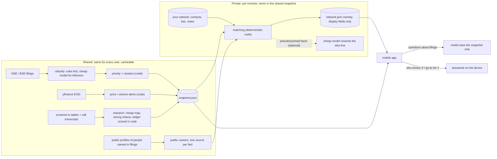

# Architecture, data security & privacy

Companion to the [README](../README.md). It covers how data moves through FINN, who can see what, how the investor's network is protected, where models are and aren't used, and what happens when things break.

Contents: [Trust boundaries](#trust-boundaries) · [Data flow for one event](#data-flow-for-one-event) · [Data pipelines](#data-pipelines) · [Security & privacy](#security--privacy) · [India's DPDP Act](#indias-dpdp-act-2023-consent-purpose-deletion) · [LLMs and agents](#llms-and-agents) · [Cloud](#cloud) · [Failure modes](#failure-modes)

## Trust boundaries

Who sees what. "Server" is the production design. In this demo the backend runs on the developer's machine and writes two JSON files.

| Data | Investor's device | FINN server | Model provider |
|---|---|---|---|
| Shared market data: filings, prices, results, research | Yes, as the snapshot | Yes. Built once for every user | Public text only: filing subjects the rules can't classify, transcript chunks, results PDFs, search snippets about executives named in filings |
| Network: contacts, employers and years, schools, closeness, "knows" links | Display fields only, in the overlay | Yes, owner-only store with row-level security. Matching runs here | Never |
| Private notes, exact last-spoke dates | Yes, and only here | No. Matching gets "N months ago" | Never |
| Network questions in Ask ("who knows…", "go-to for…") | Answered here | Not involved | Never |
| Other Ask questions | Asked here | Not involved | The snapshot only, and only when FINN runs as a Claude artifact. On Vercel the on-device router answers |
| "Why call them" line (optional, `--model`) | Shows the result | Builds the pseudonymised request, puts the name back, caches it under the owner's private namespace | "Contact A", the one matched role, org and years, and the public event |

Demo caveat: the public Vercel page bundles the synthetic overlay. A real deployment serves it only to its owner, behind sign-in.

## Data flow for one event

How HDFC Bank's CEO filing (27 Oct) becomes "Your way in: Vikram Rao (strong)". **[code]** marks deterministic code; **[model could run]** marks the only places a model is ever called, and what happens instead in this demo.

1. **Fetch** [code]. Live mode pulls NSE's announcements API, falling back to BSE per ticker. The demo replays the captured feed. Result: a filing titled "Change in Managing Director & CEO".
2. **Classify** [code; model could run]. Regex rules label it `management_change/top`. A cheap model would see the subject only if no rule matched; here one did.
3. **Score** [code]. Priority 91/100 puts it in "needs you".
4. **Name** [code; model could run]. A regex pulls "Anup Bagchi, MD & CEO" from the filing text. The cheap model is the fallback if the regex finds nothing.
5. **Background** [model could run]. Live mode searches the web and the cheap model writes the bio from the snippets only. The structured career used for matching is in `public_careers.json`, one cited source per fact, with unknown years left null.
6. **Snapshot** [code]. The filing, label, score and bio go into the shared `snapshot.json`, the same for every user.
7. **Match** [code, per user]. `overlay.py` resolves the name exactly against the public register. For each contact, `match.py` compares careers:
   - Vikram was at ICICI Bank 2016–22 and Bagchi was Executive Director there 2017–23, a 5-year overlap.
   - That company link, combined with a weak shared-alumni link (IIT Kanpur, year not public), scores 0.745.
   - Your tie to Vikram is "close" (0.9).
   - The path scores 0.9 × 0.745 = 0.67, which is "strong". Ritu (two hops) and others rank below.
8. **Why-line** [code; model could run]. A template fills the line from the match evidence. With `--model`, the cheap model may reword it from pseudonymised facts; it can't change the ranking.
9. **Render** [device]. The overlay is written to `network.json` and kept apart from the snapshot. The app draws the "Your way in" block, the path diagram and the summary line ("Your way in: Vikram Rao (strong)").

Nothing in steps 3, 7 or 9 involves a model, so every number on that card comes from code.

## Data pipelines

The demo runs these on demand (`snapshot`, `network`). The refresh column is the production schedule.

| Source | Fetch | Refresh | Stored as |
|---|---|---|---|
| EOD price & volume | yfinance (`.NS`) | after the close | bars per ticker; alerts computed in code |
| Filings | NSE announcements API, BSE fallback | poll every 15 min in market hours | raw filing + label + score; PDFs text-extracted once and cached by content hash |
| Fundamentals | screener.in tables; transcripts from NSE archives / IR sites | on each results filing | tables as JSON; transcripts as text chunks, content-hash keyed (never re-processed) |
| People in filings | name from the filing (regex, cheap-model fallback) → web search → structured career | on each leadership-change filing | `public_careers.json`: one source per fact, unknown years left null |
| Your network | entered or imported by you | when you edit it | private per-user store (`network.json` in the demo) |

**Linking.** Names from filings are normalised (honorifics, case, initials) and must match exactly. An ambiguous name gets no link rather than a guess. Employers and institutions resolve to canonical IDs with aliases (`orgs.json`). Groups exist only where people move between entities (ICICI, Kotak, Reliance); Tata is deliberately not one employer. The overlay is rebuilt whenever the snapshot or the network changes. It's pure code over two inputs, so it's cheap and reproducible.

## Security & privacy

**In short:**
- The network is the investor's private data about other people, and those people haven't agreed to be in it. The demo avoids this by using 31 fictional contacts.
- Built and tested today: the network never enters the shared snapshot or a model's context, and the one optional model call sees a pseudonym.
- Designed for a real product under India's DPDP Act: contacts stay pending until they confirm a notice, their data serves one stated purpose, and anyone who withdraws is erased within 30 days.
- Not built yet, and not legal advice: the consent flow, deletion jobs and access control below still need building and a lawyer's review.

- **Separation.** Market data is shared and cacheable. The network and everything derived from it lives in a per-user overlay that is never merged into the snapshot; a test enforces this. **This demo is a public static page, so it bundles a synthetic network.** A real deployment serves the overlay only to its owner, behind auth, with `Cache-Control: private, no-store`.
- **Minimisation.** Each contact holds name, employers and years, education and year, themes, how you know them, and when you last spoke. No phone numbers or emails are needed to match. Your private notes and the last-spoke dates never leave the device; the overlay carries "N months ago". Matching needs no model at all.
- **Models see the minimum.** Network questions in Ask are answered on the device; the network is never put into the model's context. The optional why-line model sees `Contact A`, the one stint that matched, and the public event. It never sees the name, how you know them, your notes or the rest of the career. The name is put back locally. Its output is cached in the owner's private namespace (`cache/private/<owner>/`), never in the shared LLM cache. Tests cover both. In production, the provider would be configured for zero retention and no training.
- **The people in your network haven't consented.** That is the honest gap in any product like this. In this demo it doesn't arise, because all 31 contacts are fictional. In a real product it is the central legal design problem, so it gets its own section below.
- **Access control.** One owner per network, enforced in the database with row-level security keyed by user ID and encrypted at rest with a per-tenant key. Firm admins can't read it by default. Sharing is opt-in and per path ("send this way in to my analyst"), never the whole network. Every read of the network is audit-logged.
- **Compliance by default.** Current employees of a listed company are flagged and demoted, bankers get a "no live mandates" note on fund raises, and reconnect nudges skip insiders. An investment firm's compliance team should be able to read this logic, which is why it's code.

### India's DPDP Act, 2023: consent, purpose, deletion

**Does the Act apply? Yes.**
- The Act doesn't cover "personal data processed by an individual for any personal or domestic purpose" (s. 3(c)(i)). A fund manager using contacts for investment work is acting professionally, so that exclusion doesn't apply. In the Act's terms, FINN (or the firm that deploys it) is the "Data Fiduciary", the party that decides why and how the data is used. Every contact is a "Data Principal", a person the data is about.
- A second exclusion covers information people chose to make public about themselves (s. 3(c)(ii)). At most, that reaches what a contact posted on their own profile. It does not cover the investor's notes, closeness ratings, "knows" links or the links FINN infers.
- Whether combining public data takes it back into the Act is unsettled. FINN therefore treats the whole network as in scope.

**Consent (s. 6).** The Act asks for consent that is "free, specific, informed, unconditional and unambiguous with a clear affirmative action" (s. 6(1)). In plain words: a person knowingly says yes to one stated use, and FINN may only use the data that use needs. They can take the yes back at any time, and taking it back must be no harder than giving it. The short list of uses that need no consent (s. 7, "certain legitimate uses") doesn't include a private map of someone's contacts. A real FINN would therefore:
1. Import every contact as **pending**, whether from the LinkedIn export, the address book or manual entry. A pending contact is matched only on what they published themselves: name, current employer and title. The investor's closeness rating, notes, past-employer years and "knows" links are added only after the contact consents.
2. Let the investor send each contact a short notice from their own account. It says what FINN stores, the one purpose, who sees it, and how to withdraw, with a one-tap confirm or decline. FINN keeps each yes on record, because the burden of proving consent sits with FINN.
3. Delete pending contacts who don't confirm within 90 days. Declining or withdrawing triggers deletion.

**Purpose limitation.** One stated purpose: telling the investor who in their own network can help them understand a company, a filing or a person.
- Nothing else. The network is not shared with colleagues or the firm, not used for marketing, not sold, and not used to train models.
- A new purpose, such as sharing a way in with an analyst, needs fresh, separate consent.

**Deletion (s. 8(7), s. 12(3)).** Once a contact takes back their consent, or FINN no longer needs their data for its one purpose, the data has to go, unless another law says to keep it. A contact can also ask for deletion directly. Any outside service that processes the data for FINN has to delete it too. FINN would:
- Erase a contact within 30 days from the network store, the private model cache, and any audit-log entries that reference them. Backups expire on their normal cycle. Overlays are recomputed, never archived, so there is no copy to chase. Logs otherwise hold events and scores, not contact fields.
- Hold nothing at the model provider, which is configured for zero retention.
- Keep only a salted hash of name plus employer on a suppression list, so a re-import can't bring the person back.
- Flag contacts unused for 12 months for the investor to keep or delete.
- Erase the whole network within 30 days of account closure.

**People named in filings** (e.g. Anup Bagchi) are handled differently. Their career facts come from company disclosures and their own published profiles, are stored with a source per fact, and are used only to match against the investor's network.

**Timing.** The DPDP Rules came out in November 2025 and phase in over 18 months. The parts on consent and notices take effect on 13 May 2027. A real FINN would be built to them from day one.

Sources: [Act, s. 3](https://future.indiankanoon.org/doc/115332071/) · [s. 6](https://www.apnilaw.com/bare-act/dpdp/section-6-digital-personal-data-protection-act-dpdp-consent) · [s. 8(7) summary](https://foxmandal.in/indias-new-digital-privacy-law-the-dpdp-act-and-rules-explained/) · [commencement dates](https://dpdp.myndsolution.com/wiki/guides/consent-notice-and-consent-managers/). Quoted phrases are the Act's own words; everything else here is my paraphrase. This is a design, not legal advice.

## LLMs and agents

| Step | Model | Why |
|---|---|---|
| Classify a filing that the rules can't | cheap: Gemini 2.5 Flash-Lite | bulk, short, cached by subject; rules handle all 72 captured filings at zero cost |
| Pull guidance sentences from transcript chunks | cheap | map step over keyword-filtered chunks only (~15% of a call) |
| Incoming executive's bio from search snippets | cheap | extraction from snippets only; "no reliable profile" is an allowed answer |
| Transcribe a results table from a PDF | cheap | copies printed numbers; EBITDA and growth are computed in Python |
| Dedupe promises + attach measures; research reduce | strong: Gemini 2.5 Pro | the two steps that need reasoning |
| Ask, non-network questions | Claude, quick tier, only when run as a Claude artifact; on-device router on Vercel | snapshot-only context; the network is never included |
| Network "why call them" line | none by default; cheap with `--model` | pseudonymised; can reword, not rerank |
| Numbers, ledger verdicts, priority, alerts, all network matching | **no model** | code, tested |

**No autonomous agents.** Research is a fixed map→reduce pipeline, not an agent loop, because every step must be auditable and cheap. The first place I would add an agent is diligence on people: given a name from a filing, plan searches, fetch profiles, reconcile conflicting dates, and return a career with one source per fact. Its tools would be bounded (search, fetch, a schema to fill), it would run under a budget, and it would never write to the investor's network.

## Cloud

- **Today:** the app is one static file on Vercel's CDN. The Python backend runs anywhere (laptop, container) and produces two JSON files.
- **Real deployment:**
  - A scheduled worker (Cloud Run job or similar) runs `snapshot --live` after the close and on each new filing, and writes the shared snapshot to Postgres and object storage. The snapshot is served from a CDN.
  - A small per-user API (FastAPI, already in `finn/api.py`) sits behind SSO. It serves the private overlay from Postgres with row-level security.
  - Model calls go out from the worker only, through the router in `llm.py`, with cost metering.
  - Region: India (Mumbai) for the private store.
  - Why: shared data is computed once for everyone. Private data is computed per user and served only to that user. Nothing private needs a GPU.

## Failure modes

What FINN does today, and the gap where there is one.

**Exchange API down.**
- **What happens:** NSE is tried first. If its session or request fails, BSE is tried for that ticker. The app keeps showing the last snapshot it was given, with its as-of time in the header.
- **The gap:** if both fail, that ticker gets no filings for the run, and the empty result is cached for 30 minutes.
- **The fix:** record a source status per ticker in the snapshot, show "filings for X unavailable since…" in the app, and refuse to replace a good snapshot with an empty one.

**A model call fails** (no key, timeout, bad JSON). No number depends on a model, so nothing on screen becomes wrong; something is missing instead:
- **Classification:** rules still label the filing. If the model fallback also fails, the filing becomes `unclassified`, scored as paperwork, and lands in "routine". It is visible but not promoted.
- **Name extraction:** the card shows the filing without a person. No network path is computed.
- **Executive bio:** the card says "No background found yet."
- **Live research run:** stops with an error and publishes nothing. The last good research stays.
- **"Why call them" line:** falls back to the labelled template. This is tested.
- **Ask:** falls back to the on-device router.

**An ambiguous name in a filing.**
- **How names are matched:** honorifics, case and middle initials are normalised, and then the name must match exactly one person in the public register.
- **Two candidates, or none:** FINN links to nobody. The card says the name didn't match a known public profile, and the "Your way in" block points to the best person who knows the company instead. This is the same path Dixon's new ED takes, since he has no public profile.
- **No guessing:** FINN never picks between two people with the same name. This is tested (`test_ambiguous_or_unknown_name_resolves_to_nobody`).
